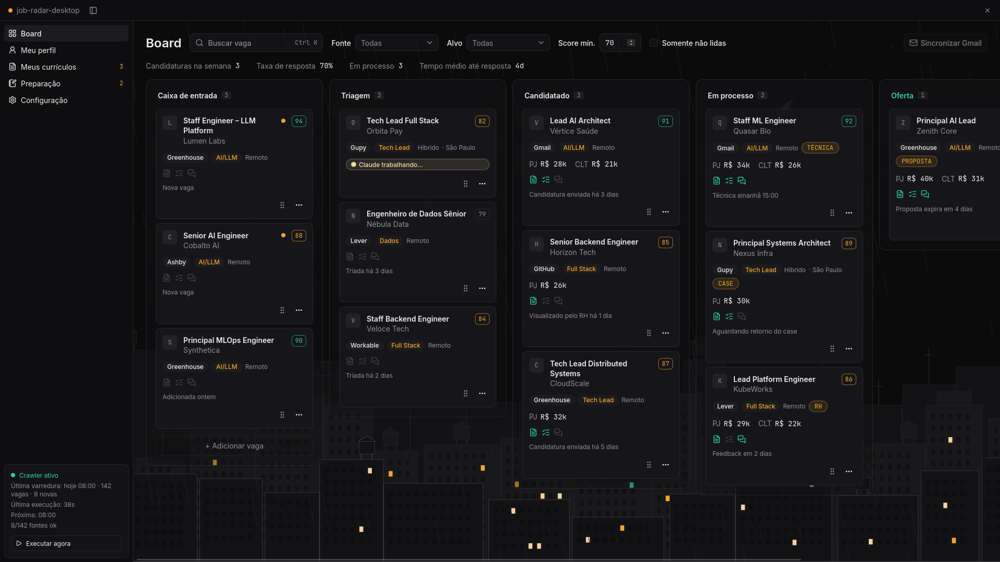

# job-radar-desktop

Local-first desktop tracker for a job search: board, filters and AI-assisted applications (Tauri + React).

[Português](README.pt-br.md)



> **Status: pre-alpha.** Cards, moves and edits are saved in a local SQLite file; there is no
> crawler or AI integration yet; see [Roadmap](#roadmap).

## Why

Developers looking for a job collect postings from a dozen sources, then lose track of what
happened next: which CV went where, who replied, which interview is next, which source never
answers. A spreadsheet or a generic Kanban board holds the list but not the context, and SaaS
trackers keep your CV and your applications on someone else's server. job-radar-desktop keeps the
whole pipeline on your machine, from inbox to hired or closed, and is built to drive the AI CLIs
you already use (Claude Code, Codex, Grok) instead of shipping its own API keys.

It pairs with [job-radar](https://github.com/nandomoreirame/job-radar), the crawler that finds and
scores the postings.

## Features

- See every application in six columns: Inbox, Triage, Applied, In process, Offer, Closed.
- Move a card by dragging it or from its menu, and record why it closed (hired, rejected, discarded, no response).
- Filter by source, target role and minimum score; the metrics strip (applications this week, response rate, average days to a reply) follows the filters.
- Open a card to edit your side of the application: salary expectation (PJ and/or CLT), recruiter contact, links, next action and notes.
- Use it in Brazilian Portuguese (default) or English.

## Quick start

Prerequisites:

- Rust 1.85 or newer (edition 2024)
- Node.js 24 and pnpm 11
- The Tauri 2 system dependencies for your OS: <https://tauri.app/start/prerequisites/> (on Linux this includes `webkit2gtk-4.1`)

```bash
git clone https://github.com/nandomoreirame/job-radar-desktop.git
cd job-radar-desktop
pnpm install
pnpm tauri dev
```

A frameless, maximized window opens. A development build starts with fictional jobs; a release build starts empty.

On Wayland, if the window stays blank, run `WEBKIT_DISABLE_DMABUF_RENDERER=1 pnpm tauri dev`
(a WebKitGTK renderer issue).

## Usage

| Action | How |
|---|---|
| Edit a job | Click the card title (or Tab to it and press Enter), change the fields and Save |
| Move a job | Drag the card, or open its "..." menu and pick a column |
| Close a job | Drop it on Closed and choose the outcome, or use "Close as" in its menu |
| Filter | Source, target and minimum score in the toolbar |
| Switch the visual style | Set `VITE_VISUAL_MODE=flat` (solid panels) or `glass` (default, translucent panels) |

Everything is saved in SQLite at `~/.local/share/dev.nandomoreira.jobradar/job-radar.db` (development builds use `dev.nandomoreira.jobradar-local`). Set `JOB_RADAR_DB` to use another file.

## Development

| Task | Command |
|---|---|
| Web tests (Vitest, jsdom) | `pnpm test` |
| Rust tests | `cd src-tauri && cargo test` |
| Type-check | `pnpm typecheck` |
| Lint | `pnpm lint` |
| Production web build | `pnpm build` |
| Desktop bundle | `pnpm tauri build` |

`cargo test`, run from `src-tauri/`, also regenerates the TypeScript types in `src/shared/bindings` from the Rust domain
(ts-rs), so the React side never redeclares them.

Layout: `src-tauri/` holds the Rust domain, the `Store` trait and the IPC commands; `src/` is the
React app in Feature-Sliced Design (`app`, `pages`, `widgets`, `features`, `entities`, `shared`).
Specs and implementation plans live in [docs/](docs/).

## Roadmap

MVP progress and every planned milestone live in [ROADMAP.md](ROADMAP.md). The main ones:

- SQLite store by default, with an optional Postgres on a self-hosted server.
- Port of the job-radar crawler to Rust, runnable headless from a timer (`job-radar crawl`).
- AI actions through your local CLIs: tailored CV, coverage review, interview prep.
- Gmail sync of recruiter replies through the CLIs' MCP servers.
- An MCP server mode (`job-radar mcp`) so AI CLIs can read and update the board.

## Security

- **No network access.** The app makes no HTTP requests; the content security policy only allows
  the Tauri IPC channel (`connect-src ipc: http://ipc.localhost`).
- **No open port.** The frontend talks to Rust through Tauri IPC, not a local web server. Only
  `pnpm tauri dev` starts Vite on `localhost:1420`, for development.
- **Minimal permissions.** The window gets Tauri's core defaults plus minimize, maximize, close
  and drag for the custom title bar; no shell, file system or HTTP plugins are enabled.
- **IPC input is validated.** Card ids are bounded (1 to 64 characters) and stage/outcome pairs
  are checked in Rust before any data changes.
- **Local data only.** Jobs live in a SQLite file in your data directory, created readable only by you (0600); the browser storage keeps only the visual mode.

Planned features change this surface: running AI CLIs and reading Gmail will be opt-in, with
read-only Gmail access and an explicit tool allowlist per action. To report a vulnerability,
open a private security advisory on this repository.

## Contributing

Issues and pull requests are welcome. Run `pnpm test`, `pnpm typecheck`, `pnpm lint` and the
Rust tests before opening a PR.

## License

[MIT](LICENSE) © 2026 Fernando Moreira Costa
