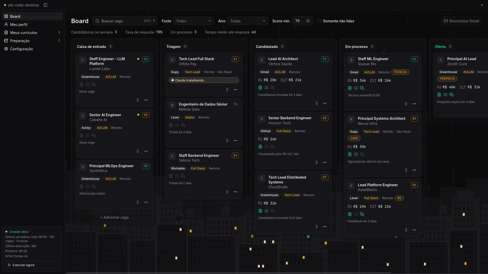

# job-radar-desktop

Rastreador desktop local-first para busca de emprego: board, filtros e candidaturas com apoio de IA (Tauri + React).

[English](README.md)



> **Status: pré-alpha.** O board roda com dados fictícios servidos pelo Rust. Ainda não há banco
> de dados, crawler nem integração com IA; veja o [Roadmap](#roadmap).

## Por quê

Quem procura emprego em tecnologia junta vagas de uma dúzia de fontes e depois perde o fio do que
aconteceu: qual currículo foi para onde, quem respondeu, qual é a próxima entrevista, qual fonte
nunca dá retorno. Uma planilha ou um Kanban genérico guarda a lista, mas não o contexto, e os
rastreadores SaaS deixam seu currículo e suas candidaturas no servidor de outra pessoa. O
job-radar-desktop mantém o funil inteiro na sua máquina, da caixa de entrada até a contratação ou o
encerramento, e foi pensado para usar as CLIs de IA que você já tem (Claude Code, Codex, Grok) em
vez de trazer as próprias chaves de API.

Ele trabalha junto com o [job-radar](https://github.com/nandomoreirame/job-radar), o crawler que
encontra e pontua as vagas.

## Recursos

- Veja cada candidatura em seis colunas: Caixa de entrada, Triagem, Candidatado, Em processo, Oferta, Encerradas.
- Mova um card arrastando ou pelo menu dele, e registre por que ele foi encerrado (contratado, recusada, descartada, sem resposta).
- Filtre por fonte, alvo e score mínimo; a faixa de métricas (candidaturas na semana, taxa de resposta, dias até a resposta) acompanha os filtros.
- Abra um card para editar o seu lado da candidatura: pretensão salarial (PJ e/ou CLT), contato do recrutador, links, próxima ação e anotações.
- Use em português do Brasil (padrão) ou em inglês.

## Instalação

Pré-requisitos:

- Rust 1.85 ou mais novo (edition 2024)
- Node.js 24 e pnpm 11
- As dependências de sistema do Tauri 2 para o seu sistema: <https://tauri.app/start/prerequisites/> (no Linux, inclui o `webkit2gtk-4.1`)

```bash
git clone https://github.com/nandomoreirame/job-radar-desktop.git
cd job-radar-desktop
pnpm install
pnpm tauri dev
```

Abre uma janela maximizada, sem bordas do sistema, com o board preenchido de vagas fictícias.

No Wayland, se a janela ficar em branco, rode `WEBKIT_DISABLE_DMABUF_RENDERER=1 pnpm tauri dev`
(um problema do renderer do WebKitGTK).

## Uso

| Ação | Como |
|---|---|
| Editar uma vaga | Clique no título do card (ou chegue nele com Tab e aperte Enter), altere os campos e salve |
| Mover uma vaga | Arraste o card, ou abra o menu "..." e escolha a coluna |
| Encerrar uma vaga | Solte em Encerradas e escolha o motivo, ou use "Encerrar como" no menu |
| Filtrar | Fonte, alvo e score mínimo na barra de ferramentas |
| Trocar o estilo visual | Defina `VITE_VISUAL_MODE=flat` (painéis sólidos) ou `glass` (padrão, painéis translúcidos) |

As mudanças ficam em memória e somem quando o app reinicia; a persistência chega com o store em SQLite.

## Desenvolvimento

| Tarefa | Comando |
|---|---|
| Testes web (Vitest, jsdom) | `pnpm test` |
| Testes Rust | `cd src-tauri && cargo test` |
| Checagem de tipos | `pnpm typecheck` |
| Lint | `pnpm lint` |
| Build web de produção | `pnpm build` |
| Pacote desktop | `pnpm tauri build` |

O `cargo test`, rodado dentro de `src-tauri/`, também regera os tipos TypeScript em `src/shared/bindings` a partir do domínio em
Rust (ts-rs), então o lado React nunca redeclara esses tipos.

Estrutura: `src-tauri/` guarda o domínio em Rust, a trait `Store` e os comandos IPC; `src/` é o app
React em Feature-Sliced Design (`app`, `pages`, `widgets`, `features`, `entities`, `shared`). Specs
e planos de implementação ficam em [docs/](docs/).

## Roadmap

O progresso até o MVP e todos os marcos planejados estão no [ROADMAP.md](ROADMAP.md) (em inglês). Os principais:

- Store em SQLite por padrão, com Postgres opcional num servidor próprio.
- Port do crawler do job-radar para Rust, rodando sem janela a partir de um timer (`job-radar crawl`).
- Ações de IA pelas suas CLIs locais: currículo sob medida, revisão de cobertura, preparação de entrevista.
- Sincronização das respostas de recrutadores no Gmail, pelos servidores MCP das CLIs.
- Um modo servidor MCP (`job-radar mcp`) para as CLIs de IA lerem e atualizarem o board.

## Segurança

- **Sem acesso à rede.** O app não faz requisições HTTP; a política de segurança de conteúdo só
  permite o canal IPC do Tauri (`connect-src ipc: http://ipc.localhost`).
- **Nenhuma porta aberta.** O frontend fala com o Rust por IPC do Tauri, não por um servidor web
  local. Só o `pnpm tauri dev` sobe o Vite em `localhost:1420`, para desenvolvimento.
- **Permissões mínimas.** A janela tem os padrões do núcleo do Tauri mais minimizar, maximizar,
  fechar e arrastar, para a barra de título própria; nenhum plugin de shell, sistema de arquivos ou
  HTTP está habilitado.
- **Entrada do IPC validada.** Os ids de card têm de 1 a 64 caracteres e os pares etapa/motivo são
  conferidos no Rust antes de qualquer dado mudar.
- **Dados só locais.** As vagas ficam em memória; o armazenamento do navegador guarda só o modo visual.

Os recursos planejados mudam essa superfície: rodar CLIs de IA e ler o Gmail serão opcionais, com
acesso ao Gmail somente leitura e uma lista explícita de ferramentas permitidas por ação. Para
relatar uma vulnerabilidade, abra um security advisory privado neste repositório.

## Contribuindo

Issues e pull requests são bem-vindos. Rode `pnpm test`, `pnpm typecheck`, `pnpm lint` e os testes
Rust antes de abrir um PR.

## Licença

[MIT](LICENSE) © 2026 Fernando Moreira Costa
